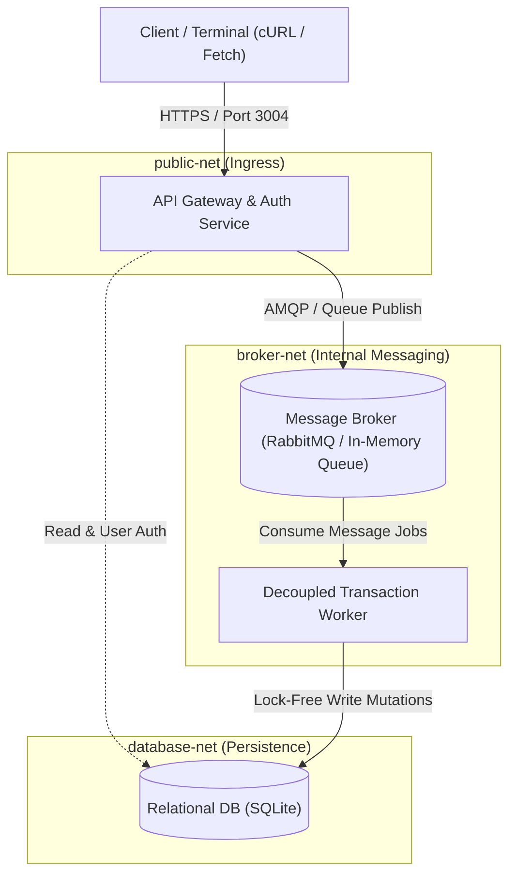

# Role-Based Microservice API Ecosystem with Asynchronous Message Brokers

A modular multi-tier application backend that handles database traffic securely under heavy loads. Built with **Node.js**, **Express**, **JWT Role-Based Access Control (RBAC)**, **Asynchronous Message Brokers (RabbitMQ & In-Memory Fallback)**, **Decoupled Background Workers**, and **Multi-Network Container Orchestration (Docker Compose)**.

---

## 📌 Table of Contents
- [Overview](#overview)
- [Key Features](#key-features)
- [Architecture & Multi-Network Topology](#architecture--multi-network-topology)
- [RBAC Authorization Tiers Matrix](#rbac-authorization-tiers-matrix)
- [Message Broker & Lock-Free Decoupling](#message-broker--lock-free-decoupling)
- [API Reference](#api-reference)
- [cURL Request & Response Examples](#curl-request--response-examples)
- [Terminal Setup & Installation](#terminal-setup--installation)
- [Automated Endpoint Verification Testing](#automated-endpoint-verification-testing)
- [Live Terminal CLI Demo](#live-terminal-cli-demo)
- [Docker Compose Orchestration](#docker-compose-orchestration)
- [Uploading to GitHub](#uploading-to-github)
- [Project Structure](#project-structure)

---

## 📖 Overview

This mini-project fulfills all requirements of **Task 4**:
1. **JWT RBAC Tiers**: Secure user authentication and fine-grained authorization (`admin`, `manager`, `user`) enforcing endpoint permissions and data isolation.
2. **Asynchronous Message Broker**: Coordinates intense transaction mutation requests through queue buffers (`transactions.queue`), preventing database locks and table contention under peak loads.
3. **Decoupled Transaction Workers**: Background worker consumers execute business logic and write finalized state to disk independently from the HTTP ingestion gateway.
4. **Network Segmentation via Docker Compose**: Isolates backend tiers across 3 distinct networks (`public-net`, `broker-net`, `database-net`).

---

## ⚡ Key Features

- **Lock-Free Transaction Ingestion**: Clients receive immediate `202 Accepted` acknowledgments with a `transactionId`, while heavy mutation work happens asynchronously in the background.
- **Dual Broker Engines**: Automatically connects to RabbitMQ (`amqp://`) when available; otherwise seamlessly falls back to a high-throughput, in-memory asynchronous queue engine with zero external dependencies.
- **Strict RBAC Enforcement**: Role-based middleware intercepts unauthorized access attempts with `403 Forbidden` and records security audit trails in `audit_logs`.
- **Automated Verification Suite**: 10 automated integration tests verify end-to-end authentication, RBAC boundaries, asynchronous queue dispatch, worker finalization, and high-concurrency burst handling.
- **Docker Compose Orchestration**: Declarative multi-container configuration with service healthchecks and segregated network bridges.

---

## 🏗 Architecture & Multi-Network Topology



---

## 🔐 RBAC Authorization Tiers Matrix

| Role Tier | Intended Persona | Permitted Capabilities |
|---|---|---|
| `user` | Standard Consumer | Register, login, queue new transactions, view personal transactions. |
| `manager` | Operations Supervisor | View all ecosystem transactions, monitor broker stats, inspect security audit logs. |
| `admin` | System Administrator | Full access: all manager privileges plus user directory administration (`/api/v1/admin/users`). |

### Seeded Credentials (Ready Out-of-the-Box)
| Username | Password | Assigned Role |
|---|---|---|
| `admin` | `AdminPass123!` | `admin` |
| `manager` | `ManagerPass123!` | `manager` |
| `alice` | `AlicePass123!` | `user` |

---

## 🔄 Message Broker & Lock-Free Decoupling

Under conventional synchronous architectures, heavy bursts of write transactions lock database tables, degrading latency and causing timeouts.

In this ecosystem:
1. **Ingress**: `POST /api/v1/transactions` verifies the incoming payload, marks an initial `queued` state, publishes the job to `transactions.queue`, and immediately returns **`202 Accepted`** (~5ms).
2. **Buffer**: The Message Broker decouples the burst spikes, absorbing high message volumes safely without database locks.
3. **Worker Processing**: Background workers consume jobs at controlled concurrency, execute ledger settlement rules, and update transaction records to `completed`.

---

## 📡 API Reference

### Authentication Service (`/api/v1/auth`)
| Method | Endpoint | Access Tier | Description |
|---|---|---|---|
| `POST` | `/api/v1/auth/register` | Public | Register a new account and receive a signed JWT |
| `POST` | `/api/v1/auth/login` | Public | Authenticate with credentials and receive a JWT token |
| `GET` | `/api/v1/auth/me` | Authenticated | Retrieve authenticated user profile |

### Transaction Service (`/api/v1/transactions`)
| Method | Endpoint | Access Tier | Description |
|---|---|---|---|
| `POST` | `/api/v1/transactions` | Authenticated (`user`, `manager`, `admin`) | Queue transaction to message broker (**202 Accepted**) |
| `GET` | `/api/v1/transactions` | Authenticated | List transactions (Users see own; Managers/Admins see all) |
| `GET` | `/api/v1/transactions/:id` | Authenticated | Get status of single transaction |

### Admin & Telemetry Service (`/api/v1/admin`)
| Method | Endpoint | Access Tier | Description |
|---|---|---|---|
| `GET` | `/api/v1/admin/audit-logs` | `manager`, `admin` | Retrieve security and compliance audit trail |
| `GET` | `/api/v1/admin/broker-stats` | `manager`, `admin` | View broker queue depth and worker throughput metrics |
| `GET` | `/api/v1/admin/users` | `admin` strictly | List all registered system accounts and role tiers |

---

## 💻 cURL Request & Response Examples

### 1. Authenticate as Regular User (`alice`)
```bash
curl -X POST http://localhost:3004/api/v1/auth/login \
  -H "Content-Type: application/json" \
  -d '{"username": "alice", "password": "AlicePass123!"}'
```
**Response (`200 OK`):**
```json
{
  "success": true,
  "message": "Login successful",
  "token": "eyJhbGciOiJIUzI1NiIsInR5cCI6IkpXVCJ9...",
  "user": {
    "id": 3,
    "username": "alice",
    "email": "alice@ecosystem.internal",
    "role": "user"
  }
}
```

---

### 2. Queue Asynchronous Transaction (Lock-Free)
```bash
curl -X POST http://localhost:3004/api/v1/transactions \
  -H "Content-Type: application/json" \
  -H "Authorization: Bearer <USER_JWT_TOKEN>" \
  -d '{
    "amount": 7500.00,
    "currency": "USD",
    "recipient": "Enterprise Cloud Logistics"
  }'
```
**Response (`202 Accepted`):**
```json
{
  "success": true,
  "message": "Transaction accepted and dispatched to asynchronous message broker queue",
  "transactionId": "3fa85f64-5717-4562-b3fc-2c963f66afa6",
  "status": "queued",
  "broker": "High-Throughput In-Memory Broker (Zero-Daemon Fallback)",
  "pollUrl": "/api/v1/transactions/3fa85f64-5717-4562-b3fc-2c963f66afa6"
}
```

---

### 3. Poll Completed Transaction State (Processed by Worker)
```bash
curl -X GET http://localhost:3004/api/v1/transactions/3fa85f64-5717-4562-b3fc-2c963f66afa6 \
  -H "Authorization: Bearer <USER_JWT_TOKEN>"
```
**Response (`200 OK`):**
```json
{
  "success": true,
  "data": {
    "id": "3fa85f64-5717-4562-b3fc-2c963f66afa6",
    "user_id": 3,
    "amount": 7500,
    "currency": "USD",
    "recipient": "Enterprise Cloud Logistics",
    "status": "completed",
    "worker_id": "worker-node-1",
    "retry_count": 0,
    "processed_at": "2026-10-18 17:24:00.120",
    "created_at": "2026-10-18 17:23:59.980"
  }
}
```

---

### 4. RBAC Violation Attempt (Regular User Accessing Admin Audit)
```bash
curl -X GET http://localhost:3004/api/v1/admin/audit-logs \
  -H "Authorization: Bearer <USER_JWT_TOKEN>"
```
**Response (`403 Forbidden`):**
```json
{
  "success": false,
  "message": "Forbidden: Access restricted. Your role 'user' does not have sufficient permissions. Required: [admin, manager]"
}
```

---

## 🛠 Terminal Setup & Installation

### Prerequisites
- Node.js v18.0.0+ (Tested on Node v22.13.0)
- npm v9.0.0+

### Terminal Commands

1. **Navigate to project directory**:
   ```bash
   cd "Internship Projects/Microservice-RBAC-MessageBroker"
   ```

2. **Install dependencies**:
   ```bash
   npm install
   ```

3. **Configure Environment**:
   ```bash
   cp .env.example .env
   ```

4. **Run Automated Endpoint Verification Tests (10 tests)**:
   ```bash
   npm test
   ```

5. **Run the Live CLI Demonstration**:
   ```bash
   npm run cli:demo
   ```

6. **Start the API Ecosystem Server**:
   ```bash
   npm start
   ```

---

## 🧪 Automated Endpoint Verification Testing

Run the automated verification suite:

```bash
npm test
```

### Verification Test Summary
- `✔` Health & Infrastructure Check (200 OK, active broker status)
- `✔` Auth: User login & JWT issuance with RBAC roles (`admin`, `manager`, `user`)
- `✔` Auth: Account registration with bcrypt password hashing
- `✔` RBAC Tier Enforcement: Admin and Manager permitted; User rejected with `403 Forbidden`
- `✔` RBAC Strict Admin Tier: `/admin/users` rejects managers with `403 Forbidden`
- `✔` Security: Rejection of unauthenticated requests (`401 Unauthorized`)
- `✔` Asynchronous Queue Ingestion: `POST /api/v1/transactions` responds with `202 Accepted`
- `✔` Decoupled Worker Processing: Worker consumes message and finalizes status to `completed`
- `✔` RBAC Data Isolation: Regular user cannot see other users' transactions
- `✔` High-Concurrency Heavy Load: 15 simultaneous transactions queued and processed safely without database locks

---

## 🖥 Live Terminal CLI Demo

Run an automated simulation showing JWT generation, RBAC rejection, queue publishing, and background worker processing:

```bash
npm run cli:demo
```

---

## 🐳 Docker Compose Orchestration

To run the complete multi-tier ecosystem with real **RabbitMQ (AMQP + Management UI)** across 3 segregated networks:

```bash
docker-compose up --build
```

- **API Gateway**: `http://localhost:3004`
- **RabbitMQ Management Dashboard**: `http://localhost:15672` (Username: `guest` / Password: `guest`)

---

## 📁 Project Structure

```text
Microservice-RBAC-MessageBroker/
├── .env.example
├── .gitignore
├── docker-compose.yml
├── Dockerfile
├── package.json
├── README.md
├── data/
│   └── ecosystem.sqlite
├── scripts/
│   ├── cliDemo.js
│   ├── resetDb.js
│   └── test.js
└── src/
    ├── app.js
    ├── server.js
    ├── api/
    │   └── routes/
    │       ├── adminRoutes.js
    │       ├── authRoutes.js
    │       └── transactionRoutes.js
    ├── broker/
    │   └── messageBroker.js
    ├── config/
    │   └── index.js
    ├── db/
    │   ├── connection.js
    │   └── schema.sql
    ├── middleware/
    │   └── auth.js
    └── worker/
        └── transactionWorker.js
```
