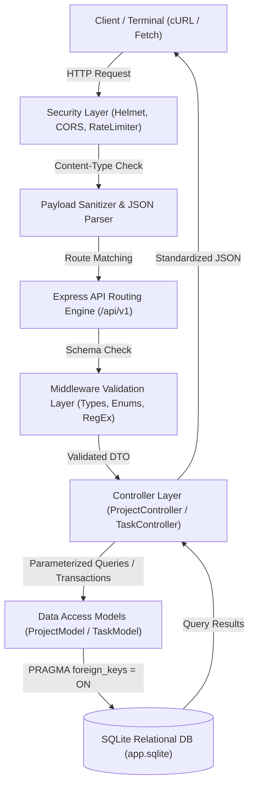
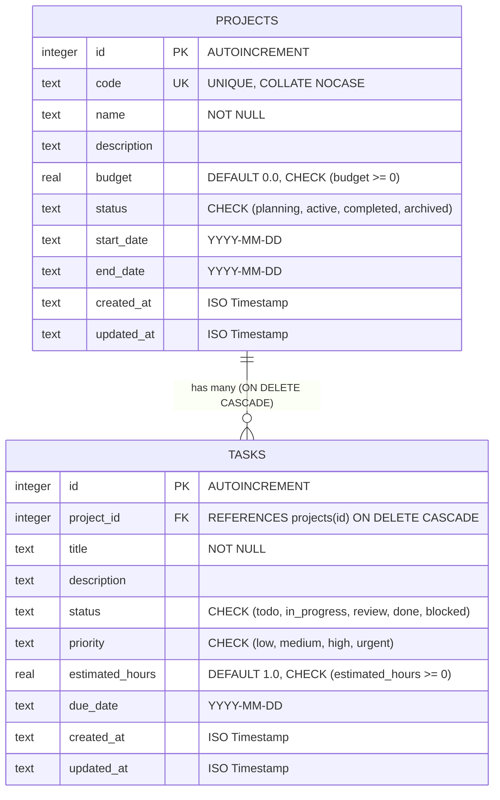

# Secured RESTful CRUD API Server with Relational Database

A scalable, secure backend application server and routing engine built with **Node.js**, **Express**, and **SQLite**. This system demonstrates relational database engineering, parameterized SQL query execution, foreign-key relational integrity with cascade rules, multi-layer validation middleware, ACID transactional data mutations, and defense-in-depth API hardening.

---

## 📌 Table of Contents
- [Overview](#overview)
- [Key Features](#key-features)
- [System Architecture](#system-architecture)
- [Database Schema & ERD](#database-schema--erd)
- [Security & Validation Architecture](#security--validation-architecture)
- [API Reference](#api-reference)
- [cURL Request & Response Examples](#curl-request--response-examples)
- [Terminal Setup & Installation](#terminal-setup--installation)
- [Running Automated Tests](#running-automated-tests)
- [Interactive Terminal CLI Demo](#interactive-terminal-cli-demo)
- [Uploading to GitHub](#uploading-to-github)
- [Project Structure](#project-structure)

---

## 📖 Overview

This service models an enterprise **Project & Task Management Engine**. It is built from the ground up to handle high-reliability, secure data mutations with strict relational constraints:

1. **Relational Database Integration**: Connects to an SQL relational database (SQLite) enforcing active foreign keys, type constraints, unique indexes, and a dedicated SQL summary view.
2. **ACID Transactions**: Atomic mutations when creating projects with nested tasks, guaranteeing complete rollback upon failure.
3. **Middleware Layer Validation**: Inspects incoming HTTP payloads before reaching database drivers, catching bad types, string overflows, negative numeric boundaries, and unauthorized properties.
4. **Security Hardened**: Protected against SQL Injection (parameterized statements), Cross-Site Scripting / Header vulnerabilities (Helmet), abuse (Rate Limiting), prototype pollution, and Content-Type spoofing.

---

## ⚡ Key Features

- **Full Relational CRUD**: Comprehensive endpoints for Projects and Tasks (`GET`, `POST`, `PUT`, `PATCH`, `DELETE`).
- **Foreign Key Integrity & Cascading**: Deleting a project automatically and cleanly cascades to remove associated child tasks via `ON DELETE CASCADE`.
- **Atomic Transactional Mutations**: Batch-create a project with initial tasks in a single atomic database transaction.
- **Relational Aggregates & SQL View**: Pre-computed metrics (total tasks, completion percentage, total estimated hours) via `project_summary_view`.
- **Structured Error Responses**: Standardized JSON error responses (`400 Bad Request`, `404 Not Found`, `409 Conflict`, `415 Unsupported Media Type`, `500 Internal Server Error`).
- **Terminal-First Workflow**: Seamless CLI scripts for database migration, seeding, resetting, running automated tests, and terminal demonstrations.

---

## 🏗 System Architecture



---

## 🗄 Database Schema & ERD



### Relational SQL View: `project_summary_view`
Aggregates project-level metrics in real time:
```sql
SELECT
  p.id AS project_id,
  p.code AS project_code,
  p.name AS project_name,
  p.status AS project_status,
  p.budget AS project_budget,
  COUNT(t.id) AS total_tasks,
  SUM(CASE WHEN t.status = 'done' THEN 1 ELSE 0 END) AS completed_tasks,
  ROUND(
    CASE
      WHEN COUNT(t.id) = 0 THEN 0.0
      ELSE (CAST(SUM(CASE WHEN t.status = 'done' THEN 1 ELSE 0 END) AS REAL) / COUNT(t.id)) * 100.0
    END, 2
  ) AS progress_percentage,
  COALESCE(SUM(t.estimated_hours), 0.0) AS total_estimated_hours
FROM projects p
LEFT JOIN tasks t ON p.id = t.project_id
GROUP BY p.id;
```

---

## 🛡 Security & Validation Architecture

| Protection Layer | Implementation Mechanism | Defensive Purpose |
|---|---|---|
| **SQL Injection (SQLi)** | Parameterized Prepared Queries (`?` placeholders) | Prevents arbitrary query injection and data leakage. |
| **HTTP Headers** | `helmet` | Enforces HSTS, DNS Prefetch Control, Frameguard, and X-Content-Type-Options. |
| **Rate Limiting** | `express-rate-limit` | Throttles incoming client requests to prevent brute-force and DoS. |
| **Content-Type Filter** | `enforceJsonContentType` middleware | Rejects non-JSON mutation payloads (`POST`, `PUT`, `PATCH`) with `415`. |
| **Payload Sanitization** | `sanitizePayload` middleware | Prevents JavaScript prototype pollution attacks (`__proto__`, `constructor`). |
| **Input Validation** | Custom schema validator middleware | Validates string lengths, positive numbers, regex patterns, and enums. |
| **Error Masking** | Centralized `errorHandler` | Shields client from database internal stack traces while logging cleanly on terminal. |

---

## 📡 API Reference

### Health & Analytics
| Method | Endpoint | Description | Status Code |
|---|---|---|---|
| `GET` | `/health` | Service health status & database connectivity check | `200 OK` |
| `GET` | `/api/v1/stats` | Aggregated system metrics from SQL relational view | `200 OK` |

### Projects Resource (`/api/v1/projects`)
| Method | Endpoint | Description | Status Code |
|---|---|---|---|
| `GET` | `/api/v1/projects` | List projects (supports `?status=`, `?search=`, pagination & sorting) | `200 OK` |
| `GET` | `/api/v1/projects/:id` | Get single project with all linked child tasks | `200 OK` / `404` |
| `POST` | `/api/v1/projects` | Create project (supports atomic nested task creation) | `201 Created` / `400` / `409` |
| `PUT` | `/api/v1/projects/:id` | Full replacement update of a project | `200 OK` / `404` / `400` / `409` |
| `PATCH` | `/api/v1/projects/:id` | Partial update of specific fields | `200 OK` / `404` / `400` / `409` |
| `DELETE` | `/api/v1/projects/:id` | Delete project and cascade-delete child tasks | `200 OK` / `404` |
| `GET` | `/api/v1/projects/:id/tasks` | Get all tasks belonging to this project | `200 OK` / `404` |

### Tasks Resource (`/api/v1/tasks`)
| Method | Endpoint | Description | Status Code |
|---|---|---|---|
| `GET` | `/api/v1/tasks` | List tasks (supports `?projectId=`, `?status=`, `?priority=`, `?search=`) | `200 OK` |
| `GET` | `/api/v1/tasks/:id` | Get single task joined with parent project metadata | `200 OK` / `404` |
| `POST` | `/api/v1/tasks` | Create task linked to parent project | `201 Created` / `400` / `404` |
| `PUT` | `/api/v1/tasks/:id` | Full replacement update of a task | `200 OK` / `404` / `400` |
| `PATCH` | `/api/v1/tasks/:id` | Partial update of task fields (e.g. status) | `200 OK` / `404` / `400` |
| `DELETE` | `/api/v1/tasks/:id` | Delete task by ID | `200 OK` / `404` |

---

## 💻 cURL Request & Response Examples

### 1. Health & Database Check
```bash
curl -X GET http://localhost:3002/health
```
**Response (`200 OK`):**
```json
{
  "status": "UP",
  "service": "Secured Relational CRUD API Server",
  "database": "CONNECTED (SQLite Relational)",
  "environment": "development",
  "uptimeSeconds": 42,
  "timestamp": "2026-10-18T17:15:00.000Z"
}
```

---

### 2. Transactional Mutation: Create Project with Nested Tasks
```bash
curl -X POST http://localhost:3002/api/v1/projects \
  -H "Content-Type: application/json" \
  -d '{
    "code": "FIN-SYS",
    "name": "Financial Ledger Microservice",
    "description": "Double-entry accounting service with audit logging",
    "budget": 75000.00,
    "status": "active",
    "start_date": "2026-11-01",
    "tasks": [
      {
        "title": "Build ledger schema and audit triggers",
        "priority": "urgent",
        "estimated_hours": 18.0
      },
      {
        "title": "Implement reconciliation endpoints",
        "priority": "high",
        "estimated_hours": 24.5
      }
    ]
  }'
```
**Response (`201 Created`):**
```json
{
  "success": true,
  "message": "Project created successfully",
  "data": {
    "id": 4,
    "code": "FIN-SYS",
    "name": "Financial Ledger Microservice",
    "description": "Double-entry accounting service with audit logging",
    "budget": 75000,
    "status": "active",
    "start_date": "2026-11-01",
    "end_date": null,
    "tasks": [
      {
        "id": 10,
        "project_id": 4,
        "title": "Build ledger schema and audit triggers",
        "status": "todo",
        "priority": "urgent",
        "estimated_hours": 18
      },
      {
        "id": 11,
        "project_id": 4,
        "title": "Implement reconciliation endpoints",
        "status": "todo",
        "priority": "high",
        "estimated_hours": 24.5
      }
    ]
  }
}
```

---

### 3. List Projects with Computed Progress & Metrics
```bash
curl -X GET "http://localhost:3002/api/v1/projects?status=active&sortBy=budget&sortOrder=DESC"
```
**Response (`200 OK`):**
```json
{
  "success": true,
  "count": 1,
  "total": 1,
  "data": [
    {
      "id": 4,
      "code": "FIN-SYS",
      "name": "Financial Ledger Microservice",
      "budget": 75000,
      "status": "active",
      "total_tasks": 2,
      "completed_tasks": 0,
      "progress_percentage": 0
    }
  ]
}
```

---

### 4. Create Task with Relational Foreign Key
```bash
curl -X POST http://localhost:3002/api/v1/tasks \
  -H "Content-Type: application/json" \
  -d '{
    "project_id": 4,
    "title": "Configure automated database backup cron",
    "status": "in_progress",
    "priority": "medium",
    "estimated_hours": 6.0,
    "due_date": "2026-11-10"
  }'
```
**Response (`201 Created`):**
```json
{
  "success": true,
  "message": "Task created successfully",
  "data": {
    "id": 12,
    "project_id": 4,
    "project_code": "FIN-SYS",
    "project_name": "Financial Ledger Microservice",
    "title": "Configure automated database backup cron",
    "status": "in_progress",
    "priority": "medium",
    "estimated_hours": 6,
    "due_date": "2026-11-10"
  }
}
```

---

### 5. Validation Middleware Error Handling (Example)
```bash
curl -X POST http://localhost:3002/api/v1/projects \
  -H "Content-Type: application/json" \
  -d '{
    "code": "X",
    "name": "No",
    "budget": -50,
    "status": "invalid_status"
  }'
```
**Response (`400 Bad Request`):**
```json
{
  "success": false,
  "message": "Validation failed",
  "errors": [
    {
      "field": "code",
      "message": "Code is required, must be 2-20 characters long, and contain only letters, numbers, hyphens, and underscores (e.g. PROJ-01)"
    },
    {
      "field": "name",
      "message": "Name is required and must be between 3 and 150 characters"
    },
    {
      "field": "budget",
      "message": "Budget must be a non-negative number"
    },
    {
      "field": "status",
      "message": "Status must be one of: planning, active, completed, archived"
    }
  ]
}
```

---

### 6. Relational Integrity Violation (Parent Project Not Found)
```bash
curl -X POST http://localhost:3002/api/v1/tasks \
  -H "Content-Type: application/json" \
  -d '{
    "project_id": 99999,
    "title": "Orphaned Task"
  }'
```
**Response (`404 Not Found`):**
```json
{
  "success": false,
  "message": "Parent project not found",
  "errors": [
    {
      "field": "project_id",
      "message": "No project exists with ID 99999"
    }
  ]
}
```

---

### 7. Unique Constraint Conflict (Duplicate Code)
```bash
curl -X POST http://localhost:3002/api/v1/projects \
  -H "Content-Type: application/json" \
  -d '{
    "code": "FIN-SYS",
    "name": "Duplicate Project"
  }'
```
**Response (`409 Conflict`):**
```json
{
  "success": false,
  "message": "Conflict: Project code already exists",
  "errors": [
    {
      "field": "code",
      "message": "A project with code 'FIN-SYS' already exists"
    }
  ]
}
```

---

## 🛠 Terminal Setup & Installation

### Prerequisites
- **Node.js**: v18.0.0 or newer (tested on v22.13.0)
- **npm**: v9.0.0 or newer (tested on v10.9.2)

### Terminal Commands

1. **Navigate to the project directory**:
   ```bash
   cd "Internship Projects/Secured-Relational-CRUD-API"
   ```

2. **Install dependencies**:
   ```bash
   npm install
   ```

3. **Configure Environment Variables**:
   ```bash
   cp .env.example .env
   ```

4. **Execute Schema Migrations**:
   Creates tables, indexes, constraints, and views:
   ```bash
   npm run migrate
   ```

5. **Seed the Relational Database**:
   Populates projects and related tasks with sample data:
   ```bash
   npm run seed
   ```

6. **Start Development Server** (with live reload via `--watch`):
   ```bash
   npm run dev
   ```

7. **Start Production Server**:
   ```bash
   npm start
   ```
   The API will be live at `http://localhost:3002`.

---

## 🧪 Running Automated Tests

A comprehensive integration test suite verifies all CRUD operations, schema constraints, validation rules, relational cascade deletions, and SQL injection protections:

```bash
npm test
```

### What the test suite covers:
- `✔` Health check & active database connectivity verification
- `✔` Seed verification & relational data retrieval
- `✔` Single project lookup with nested child tasks
- `✔` Project creation (valid payload)
- `✔` Unique constraint validation (`409 Conflict` on duplicate code)
- `✔` Validation middleware edge cases (bad types, negative numbers, bad enums)
- `✔` Route parameter validation (`400 Bad Request` on non-integer ID)
- `✔` Full resource replacement (`PUT`)
- `✔` Partial field mutation (`PATCH`)
- `✔` Task creation with active foreign key relation
- `✔` Foreign key integrity check (`404` when referenced parent does not exist)
- `✔` Relational filtering & multi-field search queries
- `✔` Task status mutations
- `✔` Multi-entity transactional mutation (atomic project + tasks)
- `✔` Relational cascade deletion (`DELETE` project auto-deletes child tasks)
- `✔` Security Content-Type enforcement (`415 Unsupported Media Type`)
- `✔` SQL Injection immunity under malicious search strings
- `✔` Relational SQL View analytics & statistics

---

## 🖥 Interactive Terminal CLI Demo

Run an automated live terminal demonstration that executes live API requests and prints colorized JSON payloads and status codes directly in your terminal:

```bash
npm run cli:demo
```

---

## 🚀 Uploading to GitHub

When you are ready to upload this project to GitHub, follow these steps:

### Option A: Push as part of the current repository
If you are committing this project into your existing `Backend_Development_Projects` repository:

```bash
# From repository root:
git add "Internship Projects/Secured-Relational-CRUD-API"
git commit -m "feat: add Secured RESTful CRUD API Server with Relational Database (Task 2)"
git push origin main
```

### Option B: Push as an independent standalone repository
If you wish to create a dedicated standalone GitHub repository for this specific project:

```bash
# 1. Navigate into the project folder
cd "Internship Projects/Secured-Relational-CRUD-API"

# 2. Initialize a new git repository
git init

# 3. Add all project files
git add .

# 4. Create initial commit
git commit -m "feat: initial commit - secured relational CRUD API server"

# 5. Link your GitHub repository (replace with your repo URL)
git remote add origin <YOUR_GITHUB_REPO_URL>

# 6. Push to GitHub
git branch -M main
git push -u origin main
```

---

## 📁 Project Structure

```text
Secured-Relational-CRUD-API/
├── .env.example                  # Template for environment variables
├── .gitignore                    # Excludes node_modules, local sqlite DB, and logs
├── Dockerfile                    # Containerization instructions
├── package.json                  # NPM scripts and dependency definitions
├── package-lock.json             # Locked dependency tree
├── README.md                     # Comprehensive documentation
├── render.yaml                   # Cloud deployment blueprint
├── data/                         # Local database storage directory (.sqlite)
├── scripts/
│   ├── cliDemo.js                # Live terminal demonstration script
│   ├── migrate.js                # CLI runner for schema migrations
│   ├── resetDb.js                # CLI utility to wipe and reseed database
│   ├── seed.js                   # CLI runner for database seeding
│   └── test.js                   # 18-step automated integration test suite
└── src/
    ├── app.js                    # Express app configuration & middleware mounts
    ├── server.js                 # Server startup, connection lifecycle & shutdown
    ├── config/
    │   └── index.js              # Environment variable parser
    ├── controllers/
    │   ├── projectController.js  # Project CRUD & transactional actions
    │   ├── statsController.js    # Relational SQL view analytics
    │   └── taskController.js     # Task CRUD & foreign key actions
    ├── db/
    │   ├── connection.js         # SQLite connection manager & query helpers
    │   ├── migrate.js            # Migration logic
    │   ├── schema.sql            # Relational SQL DDL (tables, FKs, checks, views)
    │   └── seed.js               # Seed records & transactional seeder
    ├── middleware/
    │   ├── errorHandler.js       # Centralized error handler & constraint mapper
    │   ├── logger.js             # Terminal request duration & status logger
    │   ├── rateLimiter.js        # DDoS & brute-force throttling
    │   ├── security.js           # Content-Type & payload sanitization
    │   └── validate.js           # Schema & type validation middleware
    ├── models/
    │   ├── projectModel.js       # Project database queries & transactions
    │   └── taskModel.js          # Task database queries & joins
    └── routes/
        ├── projectRoutes.js      # Project route declarations & middleware hooks
        ├── statsRoutes.js        # Stats route declarations
        └── taskRoutes.js         # Task route declarations & middleware hooks
```

---

## 📜 License
This project is licensed under the MIT License.
