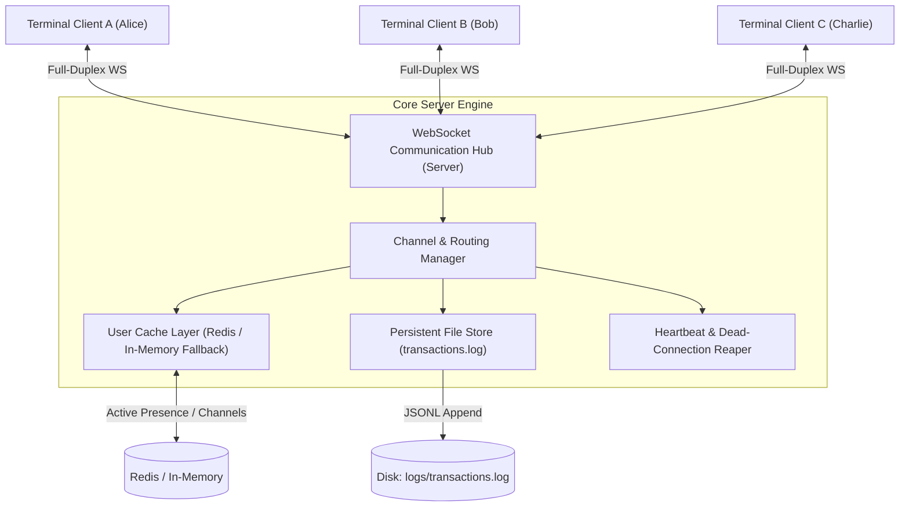

# Concurrent WebSocket Real-Time Communication Hub

A high-concurrency instant messaging backend server and full-duplex communication hub built with **Node.js**, **WebSockets (`ws`)**, **In-Memory/Redis Caching**, and **Persistent File Logging**. Designed to handle real-time event broadcasting, multi-channel subscriptions, user presence tracking, and auditable transaction logging under high throughput.

---

## 📌 Table of Contents
- [Overview](#overview)
- [Key Features](#key-features)
- [Architecture Diagram](#architecture-diagram)
- [WebSocket Message Protocol](#websocket-message-protocol)
- [HTTP Diagnostics & Log Endpoints](#http-diagnostics--log-endpoints)
- [In-Memory & Redis Caching Layer](#in-memory--redis-caching-layer)
- [Persistent Transaction File Store](#persistent-transaction-file-store)
- [Terminal Setup & Installation](#terminal-setup--installation)
- [Running Automated Tests](#running-automated-tests)
- [Interactive Terminal Chat Client](#interactive-terminal-chat-client)
- [Live Terminal CLI Demo](#live-terminal-cli-demo)
- [Docker & Container Orchestration](#docker--container-orchestration)
- [Uploading to GitHub](#uploading-to-github)
- [Project Structure](#project-structure)

---

## 📖 Overview

The **Concurrent WebSocket Real-Time Communication Hub** fulfills the requirements of Task 3:
1. **Live Full-Duplex Pipelines**: Native WebSocket protocol (`ws`) for bi-directional real-time message streams.
2. **Multiple Chat Channels**: Channel routing supporting default rooms (`#general`, `#engineering`, `#alerts`, `#devops`) and dynamic ad-hoc channels.
3. **In-Memory User Caching (Redis)**: Tracks active sessions, connected channels, and client IPs using Redis with an automated zero-daemon in-memory fallback.
4. **Persistent File Logging**: Appends structured transaction timestamps and audit metadata to disk (`logs/transactions.log`).

---

## ⚡ Key Features

- **Multi-Channel Pub/Sub**: Clients subscribe to channels and receive selective message broadcasts with transaction delivery tracking.
- **Direct Private Messaging**: Secure peer-to-peer messaging between active users.
- **Dual-Engine Presence Cache**: Connects to an external Redis instance if available; otherwise engages a high-performance in-memory cache without requiring external daemons.
- **Auditable Transaction Logging**: Every connection, channel join/leave, broadcast, and private message generates an ISO-timestamped transaction audit log.
- **Heartbeat & Zombie Pruning**: Automatic ping-pong health checks prune disconnected or stalled sockets.
- **Terminal-First Workflow**: Test suite, live CLI demo, and interactive terminal chat client out of the box.

---

## 🏗 Architecture Diagram



---

## 📡 WebSocket Message Protocol

All frames are sent and received as JSON strings over `ws://localhost:3003`.

### 1. Client Authentication / Handshake
**Sent by Client:**
```json
{
  "type": "auth",
  "userId": "usr-alice-101",
  "username": "Alice"
}
```
**Server Response (`auth_success`):**
```json
{
  "type": "auth_success",
  "userId": "usr-alice-101",
  "username": "Alice",
  "cacheEngine": "High-Performance In-Memory (Zero-Daemon Fallback)",
  "currentChannels": ["general"]
}
```

### 2. Join / Leave Channel
**Join Channel:**
```json
{ "type": "join", "channel": "engineering" }
```
**Leave Channel:**
```json
{ "type": "leave", "channel": "engineering" }
```

### 3. Send Channel Broadcast Message
**Sent by Client:**
```json
{
  "type": "message",
  "channel": "engineering",
  "content": "Production deployment is initiating now."
}
```
**Broadcast Received by Channel Subscribers:**
```json
{
  "type": "channel_message",
  "channel": "engineering",
  "transactionId": "550e8400-e29b-41d4-a716-446655440000",
  "timestamp": "2026-10-18T17:25:00.000Z",
  "sender": { "userId": "usr-alice-101", "username": "Alice" },
  "content": "Production deployment is initiating now."
}
```
**Sender Acknowledgment:**
```json
{
  "type": "message_ack",
  "transactionId": "550e8400-e29b-41d4-a716-446655440000",
  "channel": "engineering",
  "deliveredCount": 3,
  "timestamp": "2026-10-18T17:25:00.000Z"
}
```

### 4. Direct Private Messaging
**Sent by Client:**
```json
{
  "type": "direct",
  "recipientUserId": "usr-alice-101",
  "content": "Hey Alice, verify cluster certificates."
}
```

### 5. Listing Channels & Online Users
- `{ "type": "list_channels" }`: Returns all active channels and subscriber counts.
- `{ "type": "list_users" }`: Returns all active users stored in the cache.

---

## 🌐 HTTP Diagnostics & Log Endpoints

| Method | Endpoint | Description |
|---|---|---|
| `GET` | `/health` | Server health, active connection count, and cache engine status |
| `GET` | `/stats` | Channel subscriptions and cached user presence metadata |
| `GET` | `/logs?limit=50` | Reads recent persistent transaction records directly from disk |

---

## 🛠 Terminal Setup & Installation

### Prerequisites
- Node.js v18.0.0+ (Tested on Node v22.13.0)
- npm v9.0.0+

### Steps

1. **Navigate to the directory**:
   ```bash
   cd "Internship Projects/WebSocket-Realtime-Hub"
   ```

2. **Install dependencies**:
   ```bash
   npm install
   ```

3. **Configure Environment**:
   ```bash
   cp .env.example .env
   ```

4. **Run Automated Test Suite (9 integration tests)**:
   ```bash
   npm test
   ```

5. **Run the Live CLI Demonstration**:
   ```bash
   npm run cli:demo
   ```

6. **Start the Production Server**:
   ```bash
   npm start
   ```

---

## 💬 Interactive Terminal Chat Client

You can run multiple interactive chat terminals to test live messaging:

In **Terminal 1**:
```bash
npm run cli:client Alice
```

In **Terminal 2**:
```bash
npm run cli:client Bob
```

Commands available inside the chat client:
- `/join <channel>`: Switch or join a channel (e.g. `/join engineering`)
- `/channels`: List all active channels
- `/users`: List all online users
- `/dm <userId> <message>`: Send a direct private message
- `/quit`: Disconnect and exit

---

## 🐳 Docker & Container Orchestration

Run with Docker Compose (includes real Redis service):

```bash
docker-compose up --build
```

---

## 📁 Project Structure

```text
WebSocket-Realtime-Hub/
├── .env.example
├── .gitignore
├── docker-compose.yml
├── Dockerfile
├── package.json
├── README.md
├── logs/
│   └── transactions.log
├── scripts/
│   ├── cliClient.js
│   ├── cliDemo.js
│   └── test.js
└── src/
    ├── server.js
    ├── cache/
    │   └── userCache.js
    ├── channels/
    │   └── channelManager.js
    ├── config/
    │   └── index.js
    └── storage/
        └── fileLogger.js
```
